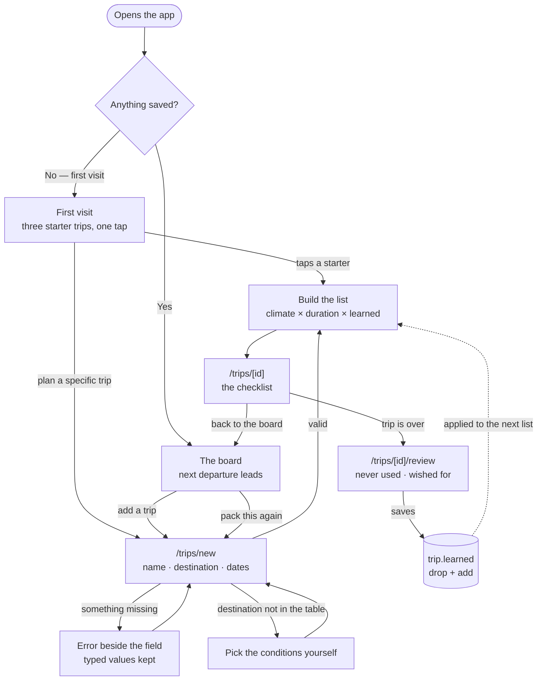
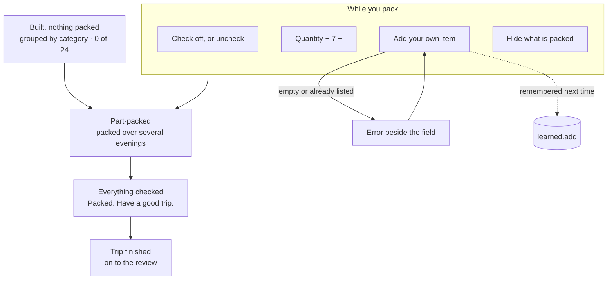

# Wanderlist

Packing lists for your favorite destinations.

You keep a few recurring trips on a board — Thanksgiving at your parents', a conference in
New York, Lisbon in March. Each one builds its own packing list from your dates and the
weather where you're going *that month*. Afterwards you say what you never used and what
you wished you'd brought, and the next time you pack that trip, the list starts already
corrected.

Built for **Design, Build, Ship · MPCS 51238 · Assignment 3 (Patterns & Flows)**.

- **Live:** https://departure-board-nine.vercel.app/
- **Flows:** [`flows.md`](./flows.md) · **Onboarding research:** [`research.md`](./research.md)
- **Agent context:** [`AGENTS.md`](./AGENTS.md)

## The core task, as one sentence

> I add a trip → the board builds its packing list from the dates and the destination →
> I check things off as I pack → I come back next time and it's already corrected from
> last trip.

## The three flows



**First visit.** Nothing is saved, so there is nothing to show — which is exactly the dead
end the brief warns about. Instead the front door offers three ready-made trips, and one
tap creates a real trip with real dates and a real packing list. Value arrives before a
single field is filled in.

Below them sits a worked example: a trip already packed twice, with its corrections shown
inline — laundry sheets marked "you added this last time", a sun hat struck through as
never used. That carries the part a first visit otherwise can't, since the loop takes two
trips to happen. A two-step strip across the top points at both halves.

**Coming back** happens on three clocks. Mid-pack, because packing takes several evenings
and a part-packed list is an invitation to finish it. Before the trip, because the board
leads with the next departure and what's still unpacked. After it, because a short review
feeds `trip.learned`.

That dashed arrow is the whole idea: a trip you repeat should cost less to pack the second
time than the first.

## The checklist

The checklist is the product — trips are just the container. It lives entirely on
`/trips/[id]`: one route, four states, four actions.



Part-packed is a first-class state rather than an in-between: packing over several
sessions is the shortest-cycle reason anyone reopens this app, so the board surfaces it
("Lisbon — 7 items left") and the list reopens exactly where it was left, filter included.

Both directions teach the list. Add an item by hand and it goes to `learned.add` *and*
your inventory; remove a suggested one and it goes to `learned.drop`. After two or three
runs of a trip, the list has converged on what you actually pack.

## A page per step, with shared navigation

Three tabs in the masthead, so where you are is always legible.

| Route | Flow | What it is |
|---|---|---|
| `/` | First visit · coming back | Home. A new person gets the onboarding here — three starter trips, one tap to a real list. Returning, it leads with the next departure. |
| `/trips` | Coming back | **Upcoming Trips.** Soonest first, each showing what's left to pack. |
| `/trips/new` | Core task | The form. Also serves `?from=<id>` to repeat a finished trip with its corrections already applied. |
| `/trips/[id]` | Core task | **The checklist.** Category sections with their own tallies, quantity steppers, and a "hide what's packed" filter that survives a reload. |
| `/trips/[id]/review` | Coming back | Two questions after the trip, which write `trip.learned`. |
| `/previous` | Coming back | **Previous Trips.** What you took, what each taught the next list, and "Pack this again". |
| `/inventory` | Coming back | What you own, how often it actually gets packed, and what you've retired. |

## How the list gets built

No forecast is fetched — the brief rules out external APIs, and the running app makes no
network call for data. [`src/lib/climate.ts`](./src/lib/climate.ts) ships approximate
monthly normals for 33 destinations instead, which suits the problem better: a trip you
repeat is usually planned well past any forecast horizon, so the real question is "what is
March usually like in Lisbon", not "what's the weather on the 14th".

`buildPackingList` combines three inputs:

| Input | Effect |
|---|---|
| Trip length | Quantities — socks and underwear scale with nights, capped at ten |
| That month's climate | Outerwear, rain gear, sun gear; a freezing low is treated differently from a merely cold day |
| `trip.learned` | Drops what you never used, adds back what you asked for |

A trip spanning a month boundary packs for the harder half — the colder high and the
wetter month — rather than the average.

Every trip states where its weather came from (`Typical for November`, and a line saying
plainly that it isn't a forecast). That came out of the research: PackPoint mixes live
forecasts with climate averages and had to start labelling which one you're looking at.

## Forms and their errors

Every error renders beside its own field, is phrased as an instruction, and **keeps what
the person typed** — validation only ever sets errors, never clears values.

| Where | Condition | Message |
|---|---|---|
| Trip name | empty | `Name this trip so you can find it again.` |
| Destination | empty | `Enter a destination.` |
| Start date | empty or unparseable | `Pick a start date.` |
| End date | empty or unparseable | `Pick an end date.` |
| End date | before the start date | `End the trip on or after it starts.` |
| Add item | empty label | `Name the item you want to add.` |
| Add item | already on the list | `Socks are already on this list.` |

A destination that isn't in the climate table is deliberately **not** an error — the form
reveals a conditions picker instead, so any destination in the world still works.

## Tech

Next.js 16.4.2 (App Router), React 19.3, Tailwind CSS v4. All state is in `localStorage`;
there is no database, no account, no backend and no external API. Deployed on Vercel's
Hobby plan.

The design system is **Café Terrace**, carried over from Assignment 2 — parchment and
pressed ink under a red awning, 0px corners, hard-offset shadows, Fraunces and Source Sans.

```bash
npm install
npm run dev
```

There's a **Reset to first visit** control in the footer, which is the quickest way to see
the onboarding again — everything is stored on one device, so it's otherwise unreachable
once you've saved a trip.

## Accessibility

Keyboard operation, real labels and error association are built into the `Field` component
rather than added afterwards — every control gets an `id` and the matching
`aria-describedby` from the same place, so a field without a properly associated label is
awkward to write.

**Text contrast was checked by computing WCAG 2.1 ratios** for all 49 text-and-background
pairs the app actually renders: every token on every surface it appears on, text on the
accent and ink fills, and each category pigment on its own tint. Four failed:

| Pair | Was | Needed | Now |
|---|---|---|---|
| `rule-strong` on the page background — every input and control edge | 2.63:1 | 3:1 (UI boundary) | **3.14:1** (`#90867C` → `#83796F`) |
| Clothing pigment on its tint | 4.23:1 | 4.5:1 | **4.89:1** (`#5F7048` → `#566642`) |
| Clothing pigment on the page background | 3.97:1 | 4.5:1 | **4.59:1** |
| Extras pigment on the page background | 4.50:1 | 4.5:1 | **4.63:1** (`#7A5E16` → `#785C16`) |

Each replacement scales HLS lightness only, so hue and saturation are untouched and the
palette still reads as one ink set. All 49 pairs now pass.

## First-run check

**Method, stated plainly:** the browser tooling available here can't attach to a remote
URL, so the live deployment was verified by request (all six routes return 200) and the
interactive pass was run against the same commit served locally. The findings are about
the code, not the hosting.

The run was a brand-new user with empty `localStorage` and one goal: *going to Lisbon next
month, don't forget anything.* Four things came out of it, all since fixed.

**1 · Five primary buttons competed on the first screen.** The design system reserves the
accent fill for *the* primary action; the first visit had it on three starter cards, the
New trip button and "Open the example" at once, so nothing read as the main path. The New
trip button and the example are now secondary. Three remain, but they're one action
repeated across parallel cards, which is what a card grid is for.

**2 · A failed submit left focus on `<body>`.** Errors rendered correctly beside their
fields and typed values survived — but nothing moved focus, so a keyboard or screen-reader
user got no signal that the submit had failed and had to hunt the form for it. Added
`focusFirstError()` to the `Field` module and wired it into all four forms; focus now lands
on the first invalid field.

**3 · The home page's static HTML was empty.** It rendered a blank 256px placeholder until
storage had been read, so a new visitor on a slow connection got a blank screen before the
JS arrived — the dead-end empty screen in a different costume. The first visit is the
correct default for someone with nothing saved, and the `data-has-trips` gate already hides
it for returning people before paint, so it now ships in the prerendered HTML. The starter
*cards* can't be: their dates are relative to today, and Cache Components won't bake a clock
reading into a static shell. So the shell is the greeting, the proposition and the
instruction, and the cards arrive with the client.

**4 · The review only offered items that had been ticked as packed.** Found earlier in the
same pass: people tick a few things and pack the rest from memory, so a sixteen-item trip
with one ticked box offered exactly one thing to review. It also withheld the items most
worth retiring — the ones never packed at all. It now offers the whole list, each row
marked "you packed this" or "never packed".

**What I'd look at next, and didn't:** the three starter trips all resolve to similar
conditions ("cool, some rain" twice, "mild, some rain" once), so the first visit
under-sells the one thing that makes the lists differ. Picking destinations and dates that
span the range — something genuinely cold, something hot — would make the climate reasoning
visible in the first three seconds. Left alone because it changes the starter set rather
than the code.
