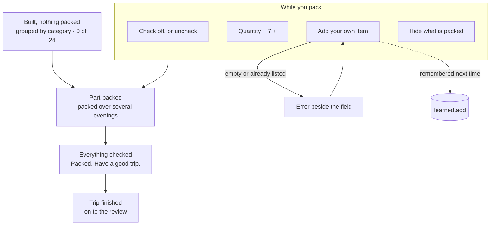

# Wanderlist

Packing lists for your favorite destinations.

You keep a few recurring trips on a board — Thanksgiving at your parents', a conference in
New York, Lisbon in March. Each one builds its own packing list from your dates and the
weather where you're going *that month*. Afterwards you say what you never used and what
you wished you'd brought, and the next time you pack that trip, the list starts already
corrected.

Built for **Design, Build, Ship · MPCS 51238 · Assignment 3 (Patterns & Flows)**.

- **Live:** https://departure-board-nine.vercel.app/
- **Flows:** [`flows.md`](./flows.md) · **Onboarding research:** [`research.md`](./research.md)
- **Agent context:** [`AGENTS.md`](./AGENTS.md)

## The core task, as one sentence

> I add a trip → the board builds its packing list from the dates and the destination →
> I check things off as I pack → I come back next time and it's already corrected from
> last trip.

## The three flows


**First visit.** Nothing is saved, so there is nothing to show — which is exactly the dead
end the brief warns about. Instead the front door offers three ready-made trips, and one
tap creates a real trip with real dates and a real packing list. Value arrives before a
single field is filled in.

Below them sits a worked example: a trip already packed twice, with its corrections shown
inline — laundry sheets marked "you added this last time", a sun hat struck through as
never used. That carries the part a first visit otherwise can't, since the loop takes two
trips to happen. A two-step strip across the top points at both halves.

**Coming back** happens on three clocks. Mid-pack, because packing takes several evenings
and a part-packed list is an invitation to finish it. Before the trip, because the board
leads with the next departure and what's still unpacked. After it, because a short review
feeds `trip.learned`.

That dashed arrow is the whole idea: a trip you repeat should cost less to pack the second
time than the first.

## The checklist

The checklist is the product — trips are just the container. It lives entirely on
`/trips/[id]`: one route, four states, four actions.



Part-packed is a first-class state rather than an in-between: packing over several
sessions is the shortest-cycle reason anyone reopens this app, so the board surfaces it
("Lisbon — 7 items left") and the list reopens exactly where it was left, filter included.

Both directions teach the list. Add an item by hand and it goes to `learned.add` *and*
your inventory; remove a suggested one and it goes to `learned.drop`. After two or three
runs of a trip, the list has converged on what you actually pack.

## A page per step, with shared navigation

Three tabs in the masthead, so where you are is always legible.

| Route | Flow | What it is |
|---|---|---|
| `/` | First visit · coming back | Home. A new person gets the onboarding here — three starter trips, one tap to a real list. Returning, it leads with the next departure. |
| `/trips` | Coming back | **Upcoming Trips.** Soonest first, each showing what's left to pack. |
| `/trips/new` | Core task | The form. Also serves `?from=<id>` to repeat a finished trip with its corrections already applied. |
| `/trips/[id]` | Core task | **The checklist.** Category sections with their own tallies, quantity steppers, and a "hide what's packed" filter that survives a reload. |
| `/trips/[id]/review` | Coming back | Two questions after the trip, which write `trip.learned`. |
| `/previous` | Coming back | **Previous Trips.** What you took, what each taught the next list, and "Pack this again". |
| `/inventory` | Coming back | What you own, how often it actually gets packed, and what you've retired. |

## How the list gets built

No forecast is fetched — the brief rules out external APIs, and the running app makes no
network call for data. [`src/lib/climate.ts`](./src/lib/climate.ts) ships approximate
monthly normals for 33 destinations instead, which suits the problem better: a trip you
repeat is usually planned well past any forecast horizon, so the real question is "what is
March usually like in Lisbon", not "what's the weather on the 14th".

`buildPackingList` combines three inputs:

| Input | Effect |
|---|---|
| Trip length | Quantities — socks and underwear scale with nights, capped at ten |
| That month's climate | Outerwear, rain gear, sun gear; a freezing low is treated differently from a merely cold day |
| `trip.learned` | Drops what you never used, adds back what you asked for |

A trip spanning a month boundary packs for the harder half — the colder high and the
wetter month — rather than the average.

Every trip states where its weather came from (`Typical for November`, and a line saying
plainly that it isn't a forecast). That came out of the research: PackPoint mixes live
forecasts with climate averages and had to start labelling which one you're looking at.

## Forms and their errors

Every error renders beside its own field, is phrased as an instruction, and **keeps what
the person typed** — validation only ever sets errors, never clears values.

| Where | Condition | Message |
|---|---|---|
| Trip name | empty | `Name this trip so you can find it again.` |
| Destination | empty | `Enter a destination.` |
| Start date | empty or unparseable | `Pick a start date.` |
| End date | empty or unparseable | `Pick an end date.` |
| End date | before the start date | `End the trip on or after it starts.` |
| Add item | empty label | `Name the item you want to add.` |
| Add item | already on the list | `Socks are already on this list.` |

A destination that isn't in the climate table is deliberately **not** an error — the form
reveals a conditions picker instead, so any destination in the world still works.

## Tech

Next.js 16.4.2 (App Router), React 19.3, Tailwind CSS v4. All state is in `localStorage`;
there is no database, no account, no backend and no external API. Deployed on Vercel's
Hobby plan.

The design system is **Café Terrace**, carried over from Assignment 2 — parchment and
pressed ink under a red awning, 0px corners, hard-offset shadows, Fraunces and Source Sans.

```bash
npm install
npm run dev
```

There's a **Reset to first visit** control in the footer, which is the quickest way to see
the onboarding again — everything is stored on one device, so it's otherwise unreachable
once you've saved a trip.

## First-run check

_Pending: run the agent against the live URL as a brand-new user, then paste its usability
feedback and the changes made in response here._
